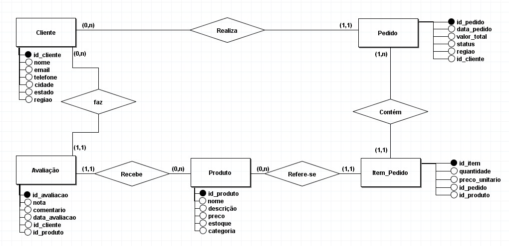
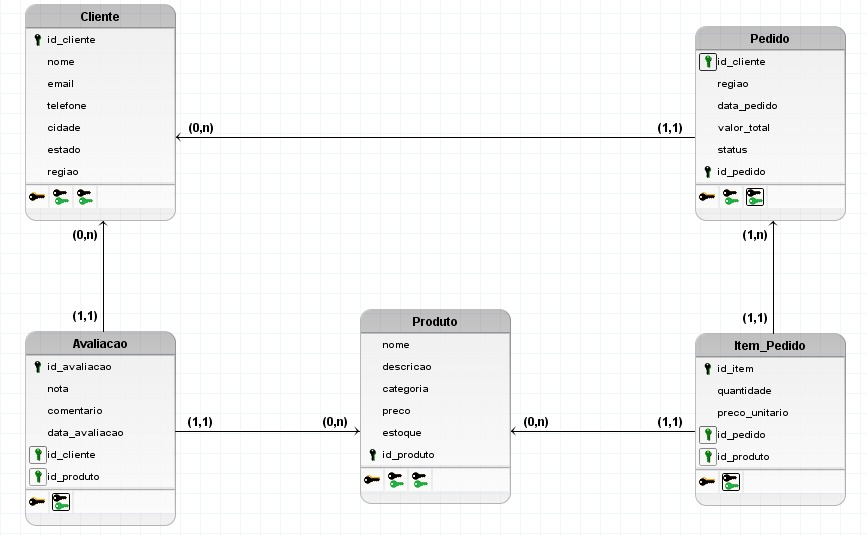

# MultiStore Distributed DB
## Documento de Projeto E1 — Planejamento e Modelagem

**Disciplina:** Banco de Dados II  
**Projeto:** MultiStore — E-commerce Multirregional Brasileiro  
**Etapa:** E1 — Planejamento e Modelagem  
**Issue:** #07  
**Status:** Consolidado para revisão da equipe

---

## 1. Apresentação

O MultiStore é um projeto acadêmico de comércio eletrônico multirregional que utiliza conceitos de bancos de dados distribuídos.

O objetivo é demonstrar a distribuição, fragmentação, reconstrução e integração de dados armazenados em diferentes SGBDs.

O projeto utilizará PostgreSQL, MySQL e MongoDB, com um gateway desenvolvido em FastAPI para centralizar as operações.

O foco está no funcionamento do banco de dados distribuído, sem necessidade de implementar uma plataforma comercial completa.

## 2. Cenário e requisitos — Issue #02

O sistema representa operações nas cinco regiões brasileiras:

- Norte
- Nordeste
- Centro-Oeste
- Sudeste
- Sul

Cada cliente pertence a uma região, definida pelo estado cadastrado. Os pedidos são associados à região do cliente no momento da compra.

O sistema deverá permitir:

- Cadastro e gerenciamento de clientes e produtos.
- Criação de pedidos e gerenciamento de seus itens.
- Cadastro e consulta de avaliações.
- Consultas regionais e globais.
- Reconstrução de informações fragmentadas.
- Integração entre bancos relacionais e documentais.
- Tratamento de falhas em operações distribuídas.

A infraestrutura será executada com Docker Compose e deverá permitir testes e geração de dados sintéticos.

**Documento de referência:** [Cenário e requisitos](01-requisitos-e-cenario.md)

## 3. Modelagem global — Issue #03

Foram definidas cinco entidades principais:

| Entidade | Descrição |
|---|---|
| Cliente | Armazena informações dos clientes |
| Produto | Representa os produtos comercializados |
| Pedido | Registra as compras realizadas |
| Item_Pedido | Representa os produtos de cada pedido |
| Avaliacao | Armazena notas e comentários dos clientes |

### 3.1 Relacionamentos

- Cliente realiza Pedido (1:N).
- Cliente faz Avaliacao (1:N).
- Produto recebe Avaliacao (1:N).
- Pedido contém Item_Pedido (1:N).
- Produto está associado a Item_Pedido (1:N).

### 3.2 Modelo Entidade-Relacionamento

### 3.3 Modelo Relacional

As chaves primárias e estrangeiras foram definidas no modelo relacional, considerando os relacionamentos entre as entidades.

**Documento de referência:** [Decisões de modelagem](modelagem/decisoes-modelagem.md)

## 4. Estratégia de fragmentação — Issue #04

A distribuição dos dados utilizará fragmentação horizontal, fragmentação vertical e armazenamento documental.

| Entidade | Estratégia |
|---|---|
| Cliente | Horizontal primária por região |
| Pedido | Horizontal primária por região |
| Item_Pedido | Horizontal derivada de Pedido |
| Produto | Vertical por atributos |
| Avaliacao | Coleção documental no MongoDB |

### 4.1 Fragmentação horizontal

Cliente e Pedido serão divididos em cinco fragmentos, conforme as regiões brasileiras.

Item_Pedido acompanhará o fragmento regional do pedido ao qual pertence.

### 4.2 Fragmentação vertical

Produto será dividido em dois fragmentos:

**PROD_COMERCIAL**
- id_produto
- nome
- categoria
- preco

**PROD_OPERACIONAL**
- id_produto
- descricao
- estoque

A chave `id_produto` será preservada em ambos os fragmentos para permitir a reconstrução.

### 4.3 Distribuição proposta

| SGBD | Dados armazenados |
|---|---|
| PostgreSQL | Clientes, pedidos e itens do Norte, Nordeste e Centro-Oeste; PROD_COMERCIAL |
| MySQL | Clientes, pedidos e itens do Sudeste e Sul; PROD_OPERACIONAL |
| MongoDB | Avaliacao |

Essa distribuição ainda depende de validação da equipe.

**Documento de referência:** [Fragmentação horizontal e vertical](03-fragmentacao-horizontal-vertical.md)

## 5. Propriedades da fragmentação — Issue #05

A fragmentação foi analisada considerando três propriedades fundamentais.

### 5.1 Completude

Todos os registros de Cliente, Pedido e Item_Pedido deverão pertencer a algum fragmento regional.

Todos os atributos de Produto estarão representados nos fragmentos verticais.

### 5.2 Disjunção

Os fragmentos horizontais serão mutuamente exclusivos, pois cada registro pertence a uma única região.

Na fragmentação vertical, somente a chave `id_produto` será repetida entre os fragmentos.

### 5.3 Reconstrução

As entidades fragmentadas horizontalmente poderão ser reconstruídas pela união dos fragmentos.

A entidade Produto será reconstruída pela junção de PROD_COMERCIAL e PROD_OPERACIONAL utilizando `id_produto`.

As propriedades foram demonstradas conceitualmente e por álgebra relacional. A validação prática ainda dependerá dos testes de implementação.

**Documento de referência:** [Propriedades formais da fragmentação](04-propriedades-fragmentacao.md)

## 6. Catálogo global e adapters — Issue #06

O catálogo global registra a localização dos fragmentos nos três SGBDs.

O gateway consultará esse catálogo para identificar o banco e o fragmento necessários a cada operação.

Os adapters terão uma interface padronizada com cinco operações:

| Operação | Finalidade |
|---|---|
| find | Consultar registros |
| insert | Inserir registros |
| update | Atualizar registros |
| delete | Excluir registros |
| count | Contar registros |

Também foram especificados padrões para filtros, respostas e tratamento de erros.

A documentação da Issue #06 foi preparada em uma branch própria e aguarda integração à `dev`.

**Arquivos de referência:**
- `config/catalogo.json`
- `docs/06-contrato-adapters.md`

## 7. Arquitetura proposta

O sistema será organizado em três camadas principais.

### 7.1 Aplicação cliente

Envia requisições para consultar ou modificar informações do MultiStore.

### 7.2 Gateway FastAPI

Responsável por:

1. Receber requisições.
2. Consultar o catálogo global.
3. Identificar os fragmentos necessários.
4. Selecionar o adapter correspondente.
5. Executar operações nos bancos.
6. Consolidar resultados distribuídos.
7. Retornar respostas padronizadas.

### 7.3 Bancos de dados

- PostgreSQL: fragmentos relacionais regionais e comerciais.
- MySQL: fragmentos relacionais regionais e operacionais.
- MongoDB: documentos de avaliações.

## 8. Integridade e consistência

O projeto deverá garantir:

- Identificadores globalmente únicos.
- Integridade dos relacionamentos entre entidades.
- Validação de referências entre SGBDs.
- Preservação dos dados durante migrações.
- Tratamento de falhas parciais.
- Prevenção de inconsistências em operações distribuídas.

A estratégia de implementação e recuperação de falhas será detalhada nas próximas etapas.

## 9. Situação das entregas

| Issue | Entrega | Situação |
|---|---|---|
| #02 | Cenário e requisitos | Documentada |
| #03 | MER, MR e decisões de modelagem | Documentada |
| #04 | Fragmentação horizontal e vertical | Documentada |
| #05 | Propriedades formais | Documentada |
| #06 | Catálogo global e adapters | PR aberto, aguardando integração |
| #07 | Documento E1 | Em preparação |

## 10. Pendências e próximos passos

Antes de considerar a etapa E1 completamente encerrada, deverão ser verificados:

- Revisão do documento pela equipe.
- Validação da alocação física dos fragmentos.
- Integração da Issue #06 à branch `dev`.
- Revisão da consistência entre os documentos.
- Registro da aprovação ou pendência do professor, conforme os critérios da Issue #07.

Após essa etapa, o projeto poderá avançar para a implementação dos bancos, adapters, gateway e testes de integração.

## 11. Conclusão

A etapa E1 estabelece a base de planejamento e modelagem do MultiStore.

Foram definidos o cenário de negócio, os requisitos, as entidades, os relacionamentos, a estratégia de fragmentação e as propriedades necessárias à reconstrução dos dados.

Também foram especificados o catálogo global e o contrato de comunicação dos adapters.

Com a revisão e validação das decisões pendentes, o projeto terá uma base documentada para iniciar sua implementação distribuída.

---

**Documento vinculado à Issue #07 — MultiStore Distributed DB.**
